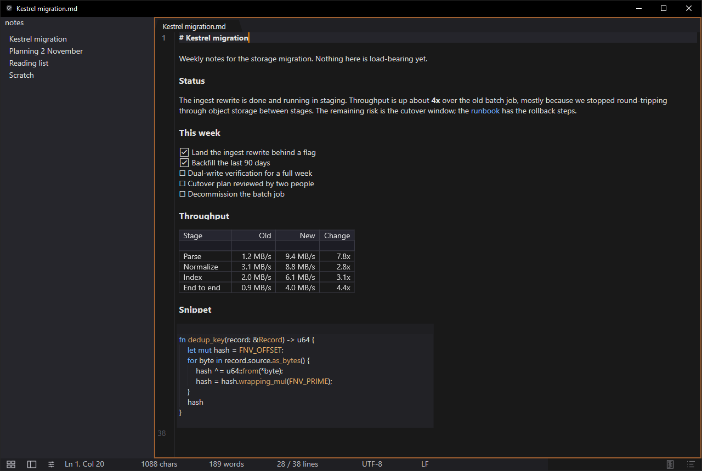
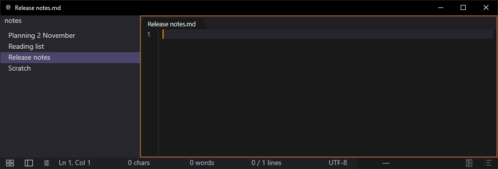
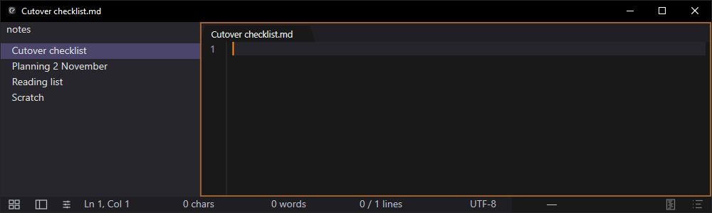
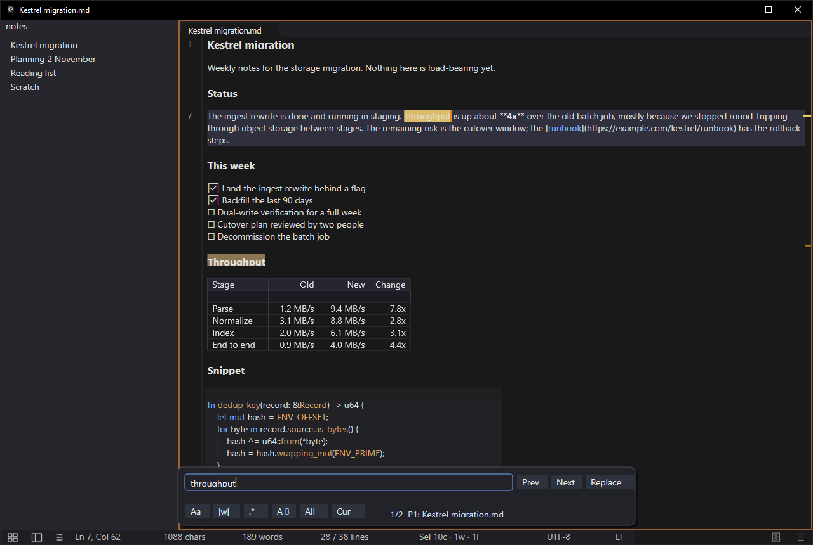

# Continuity

Continuity is a Markdown notes editor for Windows.
It handles code notes fine, but it is not trying to be a code editor.

**[Download for Windows](https://github.com/jatoran/continuity/releases/latest)** - grab `continuity-<version>-setup.msi`, or run `winget install Continuity.Continuity`.
See [Downloads](#downloads) for the portable and standalone builds.



I wanted something with the speed, ephemerality, and safety I like in Sublime Text, but aimed at notes: better Windows virtual desktop behavior, WYSIWYG markdown editing, and no "did I save?" anxiety.
Continuity saves every keystroke to a local database as you type, so if it crashes or gets force-closed, your notes, tabs and caret position are all there when you open it again.
You can still save a note to a `.md` file whenever you want one on disk, but saving is not what keeps your work safe.

It is early software and runs on Windows 10 and 11 only, and the builds are not code-signed yet, so Windows SmartScreen may warn you the first time you run one.

## Markdown renders as you type

The text is always plain Markdown, and Continuity renders it in place instead of in a separate preview pane.
The line you are on shows its raw Markdown so you can edit it, and the rest of the note shows formatted headings, lists, checkboxes, links, code and images.



The rendering is my own flavor of WYSIWYG.
Tables stay drawn as a grid that you edit cell by cell, with a right-click menu for adding and removing rows and columns, and a cell can hold a formula like `=SUM(A1:A3)`.

## If it crashes

In the recording below, Continuity is killed in the middle of a sentence and started again.
The note, the open tab and the caret position all come back, and the tab is still marked unsaved because the text was never written to a file.



## What is in this repository

This repository holds two things built on the same Rust editor engine: the Windows app, and an SDK that puts the same editor inside other applications.

| | What it is | Platform | Releases |
|---|---|---|---|
| **Continuity for Windows** | The notes app. | Windows 10/11 | `v*` tags - [latest](https://github.com/jatoran/continuity/releases/latest), [all](https://github.com/jatoran/continuity/releases?q=tag%3Av&expanded=true) |
| **Continuity SDK** | The same editor for use inside your own app, as a Web Component, a Rust crate, a C library, a Python module or a Win32 child control. | Browser, Electron, Windows, Linux, macOS | `sdk-v*` tags - [all](https://github.com/jatoran/continuity/releases?q=tag%3Asdk-v&expanded=true) |

If you want a notes editor, download the Windows app.
The SDK is for developers who want Continuity's editor inside something they are building.
The two have separate version numbers and separate releases, because they change at different rates and are used by different people.
Both are early and still changing quickly.

## Continuity for Windows

### Features

- Markdown renders in place as you type, including headings, emphasis, lists, checkboxes, links, code blocks, tables and inline images.
- The text stays plain Markdown or plain text, and nothing is converted to another format.
- Tables are drawn as a grid you edit cell by cell, with a right-click menu for rows and columns and simple formulas in cells.
- Code blocks and inline code have a copy button.
- Every keystroke is saved to a local SQLite database as you type, and saving to a file is there for when you want a file.
- Panes, tabs and windows all reopen the way you left them.
- Windows reopen on the virtual desktop they were on, and starting Continuity never switches you to a different desktop.
- Open a folder as a vault and Continuity saves every note in it automatically, remembers which notes were open, and picks up changes other programs make to those files.
- A portable mode that keeps your notes, settings, themes, keybindings and backups in the folder next to the exe.
- An MSI installer with a Start Menu shortcut, an optional desktop shortcut, a normal uninstall, and an entry in Windows Default Apps for Markdown and text files.
- Continuity checks GitHub Releases for new versions, shows a banner when one is out, and installs it when you click.
- Themes, keybindings, fonts, wrapping and view behavior are all configurable.

### Find

Find highlights every match in the note as you type, with toggles for regex, whole word, match case, and searching only the selection.



### Performance

Continuity is written in Rust and talks to Windows directly, with no browser engine or UI framework in between.
Text is drawn with DirectWrite and Direct2D, and notes are stored in SQLite.
Rendering Markdown while you type adds work to every keystroke, so typing has a budget.
A key press has to reach the screen within 8 ms, and the typed text has to reach the database within 400 ms, both at the 99th percentile.
The checks that run before every push measure both, along with the size of the exe, which has to stay under 9 MiB, and a build that goes over any of them fails.

Large notes show the part on screen first, so you can read and edit while the rest of the note is still being laid out.

### Install

```powershell
winget install Continuity.Continuity
```

winget installs the MSI, registers it with Add/Remove Programs, and picks up new versions through `winget upgrade`.
The downloads below are the same builds for anyone who prefers a file.

### Downloads

Every build is on GitHub Releases, and desktop releases are tagged `v<version>`.

[**releases/latest**](https://github.com/jatoran/continuity/releases/latest) always points at the newest desktop release, so that is the link to use.
The SDK publishes to the same release list and releases far more often, so its releases sit in between the desktop ones, but an SDK release never takes the "Latest" badge.
To see only desktop releases, filter the list with [`tag:v`](https://github.com/jatoran/continuity/releases?q=tag%3Av&expanded=true).

- `continuity-<version>-setup.msi`: recommended for normal use. Installs under Program Files and supports in-place upgrades.
- `continuity-<version>-portable.zip`: no-install build. Extract the folder and run `continuity.exe`; app data stays in that folder.
- `continuity-<version>-standalone.zip`: just `continuity.exe`; settings, themes, and notes use your normal Windows AppData.
- `SHA256SUMS.txt`: hashes for release assets.

The builds are not code-signed yet, so Windows SmartScreen may warn you before the first run.

## Continuity SDK

The Continuity SDK is the editor from the Windows app, packaged for use inside other applications.
It runs in web pages and Electron as a Web Component, and in Rust, C and Python programs as a library.
One Rust core handles the text, selections, undo history and how Markdown is displayed, and each package below is a thin layer over it, so the editor behaves the same in all of them.
The SDK does not create a database, files or background workers; your application decides where and how to save.

| Host | Use | Editor UI |
|---|---|---|
| Browser, Electron, or webview | `<continuity-editor>` Web Component | Yes |
| React, Svelte, Vue, Preact, vanilla | Framework adapters over the same WASM engine | Yes |
| JavaScript without UI | `Editor` facade | No |
| Rust | `continuity_engine::Engine` | No |
| Native Win32 Rust host | `continuity_ui::EditorControl` child HWND | Yes |
| Python | `continuity_editor.Editor` | No |
| C / C++ / any FFI host | `continuity_engine` C ABI | No |

```html
<script type="module">
  import { initialize } from "@continuity-editor/editor";
  import wasmUrl from "@continuity-editor/editor/wasm?url";

  await initialize({ wasm: wasmUrl });
</script>

<continuity-editor value="# Hello\n\nStart typing."></continuity-editor>
```

### Install

```bash
npm install @continuity-editor/editor   # browser, Electron, any JS host
cargo add continuity-engine             # Rust
```

The npm package is published under the normal `latest` tag, so the plain package name gets the current version.
The old `@next` tag stopped at 0.2.39.

`pip install continuity-editor` is not available yet.
The Python wheel is only built for Windows so far, and publishing it without wheels for other platforms would make `pip install` fail in a confusing way on Linux and macOS.

Every SDK artifact is also attached to its GitHub Release, if you would rather pin an exact file:

```powershell
gh release download sdk-v<version> --repo jatoran/continuity --dir continuity-sdk
npm install ./continuity-sdk/continuity-editor-<version>.tgz
```

Each SDK release carries the npm tarball, the `continuity-text` / `continuity-buffer` / `continuity-engine` crates, a Windows C archive (DLL plus header), a Python wheel, a CycloneDX SBOM, `release-manifest.json`, and `SHA256SUMS.txt`, all covered by GitHub build provenance attestation.

The C ABI ships as a Windows DLL plus `continuity_engine.h` in the release archive; it is not on a package registry.

SDK releases never take the repository's "Latest" badge, which always belongs to the Windows app.
An SDK release on the `preview` channel is also marked as a GitHub prerelease.

[EMBEDDING.md](EMBEDDING.md) covers the full integration contract, the API of each package, supported targets and version history, and [`packages/editor/README.md`](packages/editor/README.md) has browser and framework examples.

## Build

Requirements:

- Windows 10 or Windows 11
- Rust stable with the `x86_64-pc-windows-msvc` target
- Visual Studio Build Tools or another MSVC toolchain

Build the app:

```powershell
cargo build --release -p continuity-app
```

Build local desktop release artifacts:

```powershell
cargo xtask release --skip-sign
```

The MSI path also requires WiX v7:

```powershell
dotnet tool install --global wix --add-source https://api.nuget.org/v3/index.json
wix eula accept wix7
wix extension add --global WixToolset.UI.wixext/7.0.0
cargo xtask installer
```

Build and validate the SDK's browser artifact (requires the `wasm32-unknown-unknown` target and Node 22):

```powershell
cargo xtask browser-check
```

## License

See [LICENSE](LICENSE).
